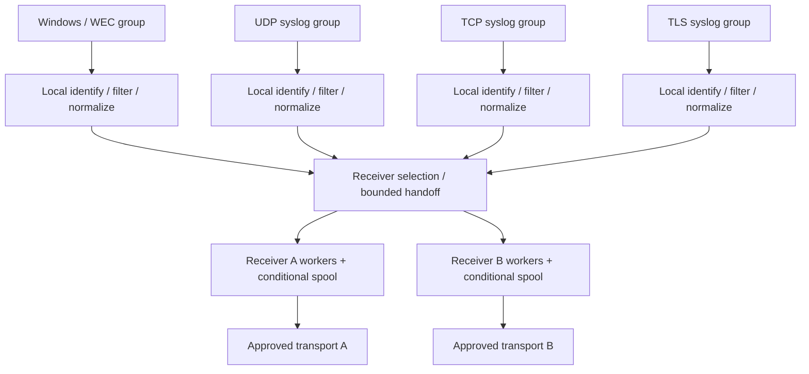

# System Architecture

**Status:** Agreed logical architecture; implementation details remain open.  
**Runtime:** One Go Windows service initially, independent supervised processing groups.

## Scope

RETRANS collects events from independent infrastructure and application sources; identifies origin and collection provenance; selects and transforms records according to locally controlled per-receiver policies; forwards over approved encrypted transports; and reports collection, processing and delivery health.

RETRANS is not a SIEM, correlation engine, investigation platform or long-term event archive. No cloud account, ELK stack, external database, or commercial service is a mandatory dependency.

## Logical data flow

Each group has its **own queue and workers**. This diagram shares only interfaces and conceptual logic, not one global processing FIFO. The routing layer must never become an unbounded queue or a single source-independent bottleneck.

## Core invariants

- No selected record is silently omitted for one receiver because another receiver has different requirements.
- No source group can create unbounded resident memory, worker count or persistent state.
- Filtering and normalization run on the fast in-memory path unless retention is actually required.
- Disk-backed receiver obligations survive restart from their durability commit point; RAM-only records do not have the same guarantee.
- Original source and collection host remain distinguishable, especially for WEC-forwarded events.
- A successful network write must never be labeled as confirmed application ingestion without an actual confirmation protocol.
- Outbound transport is encrypted and receiver identity validated under the baseline security contract.
- No client, receiver or source may independently change local policies without authorized administration.

## Reference contracts

[Source processing](SOURCE-PROCESSING.md) · [Event lifecycle](EVENT-LIFECYCLE.md) · [Filtering](FILTERING-AND-NORMALIZATION.md) · [Receiver delivery](RECEIVER-DELIVERY.md) · [Reliability](../reliability/MEMORY-FIRST-AND-SPOOLING.md).