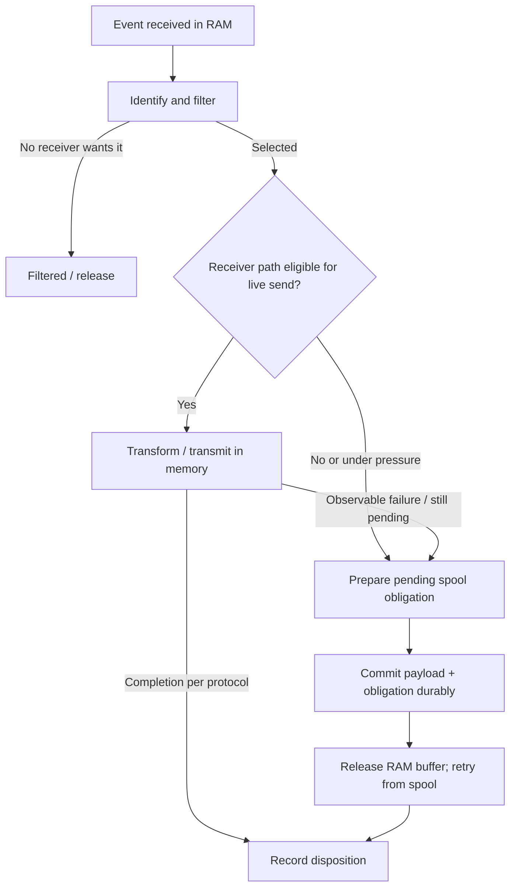

# Memory-First Processing and Conditional Spooling

**Status:** Agreed operating model; handoff mechanics and physical disk format remain open.

## Fast path

RETRANS processes source events in bounded memory, performs lightweight identification and receiver-policy selection, and delivers directly to healthy receivers. Filtered events and normally transmitted events do not require an event-payload write by RETRANS. Source systems (including Windows Event Log itself) may independently maintain their own on-disk records; those are not writes by RETRANS's spooler.

## Conditional persistence triggers

An event may enter durable spooling when: its destination is unavailable; its receiver has sustained congestion; memory queue pressure exceeds the planned threshold; a bounded replayable source is at material overwrite risk; or an administrator explicitly selects a durable-before-send profile.

A small persistent administrative/audit log may exist independently of event-payload spooling.

## State transition

## RAM-to-disk boundary

Failure after read but before a durable spool commit may lose non-replayable events; the implementation must not pretend otherwise. When a receiver fails with events in RAM, freeze or reroute the affected bounded backlog into conditional spooling and release buffers only after the relevant commit. In-flight sends may remain ambiguous and could be duplicated upon retry.

No mandatory ingress-payload write is performed first. Avoid `ingress journal -> output journal` payload copying. One durable payload may serve multiple pending obligations. Exact transaction protocol, flush batching and safe reclamation require further design.

## Source-specific behavior

| Input | Expected handling |
| --- | --- |
| UDP syslog | No reliable upstream replay or backpressure. Conditional disk spool with authorized oldest-first aging/capacity eviction; locally measurable admission losses reported. |
| TCP/TLS syslog | Bounded connection/byte queues and flow control; disk spool if authorized/needed. Do not infer sender replay from TCP. |
| Native Windows Event Log | Leverage channel's finite replay window and safe bookmarks; spool when required by selected durability or overwrite-risk policy. |
| WEC ForwardedEvents | Treat local WEC channel as finite replayable source; preserve original event origin and monitor local channel rollover risk. |

## Important distinction

Memory-first processing is **not at-least-once durability by default**. Any stronger guarantee begins only after a documented commit, receiver acknowledgment, or replayable source position under defined retention assumptions.

## Safety and bounds

Bound in-memory record count, total buffered bytes, event size, per-group worker count, per-connection input and spool admission. When RAM and persistent budgets are both exhausted, apply the defined source-specific backpressure or authorized loss policy and expose it. Do not allow unlimited RAM as a substitute for a full spool.